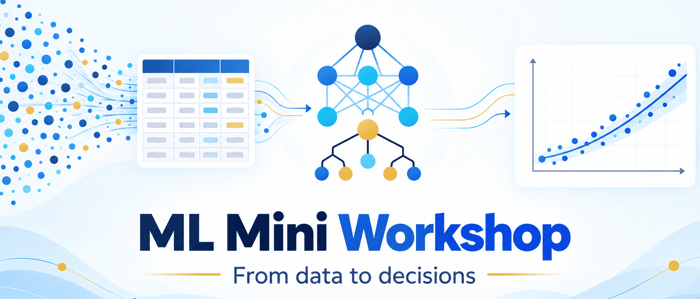

# Taller de Machine Learning aplicado a comercio electrónico

<p align="center">
  
</p>


## Descripción

Este repositorio contiene un taller educativo en español para introducir conceptos y técnicas de **Machine Learning aplicados al comercio electrónico**, utilizando el conjunto de datos público de Olist como caso de estudio. Este taller fue diseñado y desarrollado como material educativo para las actividades de formación de **Jarvis Lab**, en el marco de la **Semana de la Ingeniería 2026** de la Pontificia Universidad Javeriana.

El taller se organiza en tres rutas de aprendizaje progresivas que abordan el pronóstico de compras observadas, la predicción de recompra y la segmentación de clientes. Las tres siguen las seis fases de **CRISP-DM** (*Cross-Industry Standard Process for Data Mining*).

## Objetivos

- Comprender el flujo de trabajo de un proyecto de Machine Learning a partir de un problema de negocio.
- Aplicar las seis fases de CRISP-DM en problemas de análisis de datos.
- Explorar técnicas de pronóstico de series temporales, clasificación binaria y aprendizaje no supervisado.
- Construir variables a partir de datos transaccionales de comercio electrónico.
- Interpretar métricas y resultados, reconociendo las limitaciones de los datos y los modelos.
- Experimentar con interfaces interactivas para explorar el comportamiento de los modelos entrenados.

## Rutas de aprendizaje

| Notebook                                                             | Pregunta orientadora                                                            | Alcance                                                                                                                        |
| -------------------------------------------------------------------- | ------------------------------------------------------------------------------- | ------------------------------------------------------------------------------------------------------------------------------ |
| [`01_pronostico_demanda.ipynb`](./notebooks/01_pronostico_demanda.ipynb)       | ¿Cuántas líneas de artículos compradas podrían observarse en próximos periodos? | Ruta principal presencial (\~1 hora). Permite seleccionar una categoría, una agregación temporal y un horizonte de pronóstico. |
| [`02_prediccion_recompra.ipynb`](./notebooks/02_prediccion_recompra.ipynb)     | ¿Volverá a comprar un cliente durante una ventana futura de 90 días?            | Continuación: clasificación binaria con separación temporal para definir la variable objetivo.                                 |
| [`03_segmentacion_clientes.ipynb`](./notebooks/03_segmentacion_clientes.ipynb) | ¿Qué patrones de compra similares aparecen entre clientes?                      | Continuación: análisis RFM, escalado de variables, K-Means e interpretación exploratoria de segmentos.                         |

Cada notebook desarrolla un problema específico y concluye con una interfaz pequeña de Gradio para experimentar con el modelo.

> **Nota:** en Google Colab, las interfaces son temporales. No constituyen servicios persistentes, despliegues de producción ni recomendaciones para tomar decisiones comerciales reales.

## Metodología: CRISP-DM

Las tres rutas se estructuran alrededor de las seis fases de CRISP-DM:

1. **Comprensión del negocio:** definición del problema y de la pregunta que se busca responder.
2. **Comprensión de los datos:** exploración de las tablas, las variables y la información disponible.
3. **Preparación de los datos:** selección, transformación y construcción de variables.
4. **Modelado:** aplicación de técnicas de Machine Learning adecuadas al problema.
5. **Evaluación:** análisis de métricas, resultados y limitaciones.
6. **Despliegue:** interacción con el modelo mediante una interfaz demostrativa.

Estas fases constituyen una guía de trabajo y no un proceso estrictamente lineal. En proyectos reales, es habitual regresar a etapas anteriores cuando los resultados, la calidad de los datos o los objetivos del negocio lo requieren.

## Datos y atribución

El taller utiliza el [Brazilian E-Commerce Public Dataset by Olist](https://www.kaggle.com/datasets/olistbr/brazilian-ecommerce), publicado en Kaggle por Olist y distribuido mediante la ficha mantenida por `olistbr`.

Según la ficha de Kaggle, el conjunto contiene aproximadamente 100.000 pedidos de 2016 a 2018, distribuidos en nueve archivos CSV, con un tamaño total cercano a 126 MB.

La licencia indicada en Kaggle es [CC BY-NC-SA 4.0](https://creativecommons.org/licenses/by-nc-sa/4.0/). Sus condiciones incluyen atribuir la fuente, limitar el uso a fines no comerciales y compartir las adaptaciones bajo la misma licencia, además de cumplir los demás términos aplicables.

Antes de redistribuir los datos o utilizar derivados, se debe verificar la ficha original y las condiciones legales vigentes.

**La licencia del código no modifica la licencia de los datos.** El código educativo de este repositorio se distribuye bajo MIT, mientras que el conjunto de datos conserva las condiciones establecidas por sus titulares.

## Datos en el repositorio

La carpeta [`data/`](./data/) contiene cinco CSV públicos derivados del dataset
de Olist, con únicamente las columnas necesarias para los notebooks. Se
conservaron las filas y se omitieron códigos postales, ciudades, estados,
reseñas, pagos, datos de vendedores y geolocalización. Los identificadores de
cliente seudónimos se mantienen para enlazar pedidos y agrupar transacciones;
no se muestran en los gráficos ni en las interfaces.

La ficha oficial declara licencia CC BY-NC-SA 4.0. La selección de columnas es
una adaptación: se redistribuye con atribución a Olist, únicamente para usos no
comerciales y bajo la misma licencia. Consulte [`data/README.md`](./data/README.md)
y el [diccionario de datos](./docs/diccionario_datos.md). No se incluyen
credenciales ni archivos de Kaggle.

Los notebooks leen directamente los CSV desde las URL públicas de GitHub en
`main/data/`. No requieren descargar datos desde Kaggle, subir archivos a
Colab ni ejecutar scripts de preparación. Si la rama o ubicación del
repositorio cambia, actualice `DATA_BASE_URL` en el notebook.

## Instalación y ejecución

**Requisitos:** Python 3.10–3.13. Las versiones principales están fijadas en
[`requirements.txt`](./requirements.txt).

### Google Colab

Abra el notebook elegido desde GitHub con **Open in Colab**. Instale los
requisitos una vez en la sesión:

```python
%pip install -q -r https://raw.githubusercontent.com/JuanParias29/ML_MiniWorkshop/main/requirements.txt
```

Después ejecute las celdas en orden. El notebook carga los CSV desde este
repositorio, sin pasos de descarga ni configuración de Kaggle. La sesión y la
interfaz Gradio son temporales; guarde por separado cualquier resultado que
desee conservar.

### Ejecución local

Clone el repositorio, instale los requisitos y abra Jupyter:

```bash
python -m pip install -r requirements.txt
jupyter lab
```

Abra un notebook dentro de `notebooks/` y ejecute las celdas en orden. Hace
falta conexión a internet para leer los CSV públicos de GitHub; no se requieren
descargas de datos ni configuraciones adicionales.

## Alcance y limitaciones

Es importante distinguir entre las compras observadas y la demanda real del mercado.

El conjunto de datos registra pedidos y artículos comprados, pero no contiene información sobre inventario, disponibilidad, quiebres de stock ni demanda no satisfecha. Por tanto, los notebooks no permiten medir directamente ventas perdidas ni reconstruir la demanda que no llegó a convertirse en una compra.

Los modelos y las métricas obtenidos deben interpretarse dentro de estas limitaciones. Este material no constituye una herramienta validada para decisiones comerciales reales.

## Estructura del repositorio

```text
.
├── notebooks/
│   ├── 01_pronostico_demanda.ipynb
│   ├── 02_prediccion_recompra.ipynb
│   └── 03_segmentacion_clientes.ipynb
├── docs/
│   ├── diccionario_datos.md
│   └── banner_taller_ml.png
├── data/
│   ├── README.md
│   └── *.csv         # Tablas seleccionadas de Olist
├── requirements.txt
├── LICENSE
└── README.md
```

## Tecnologías utilizadas

- **Python:** procesamiento de datos y desarrollo de modelos.
- **Pandas:** manipulación y transformación de tablas.
- **CSV:** tablas de datos publicadas junto al repositorio.
- **Jupyter:** desarrollo y ejecución interactiva.
- **Scikit-learn:** herramientas de Machine Learning.
- **Gradio:** construcción de interfaces demostrativas.
- **CRISP-DM:** marco metodológico para estructurar el proceso analítico.

Las versiones principales de las dependencias están definidas en [`requirements.txt`](./requirements.txt).

## Autor · Juan Pablo Arias Buitrago

Científico de Datos & Presidente de Jarvis Lab · IEEE CIS

## Organización

**Jarvis Lab** es un semillero de investigación vinculado al Departamento de Ingeniería de Sistemas de la Pontificia Universidad Javeriana, relacionado con el ecosistema de IEEE Computational Intelligence Society (IEEE CIS).

El semillero promueve el aprendizaje, la investigación y el desarrollo de soluciones basadas en inteligencia artificial y disciplinas relacionadas. Este taller contribuye a sus actividades de formación mediante un recurso práctico para explorar técnicas de Machine Learning y sus aplicaciones.

## Licencia

El código fuente de este repositorio se distribuye bajo la licencia [MIT](./LICENSE).

El conjunto de datos de Olist está sujeto a sus propias condiciones de uso y licencia, descritas en la sección [Datos y atribución](#datos-y-atribucion). La licencia MIT del código no modifica ni reemplaza las condiciones aplicables a los datos.
